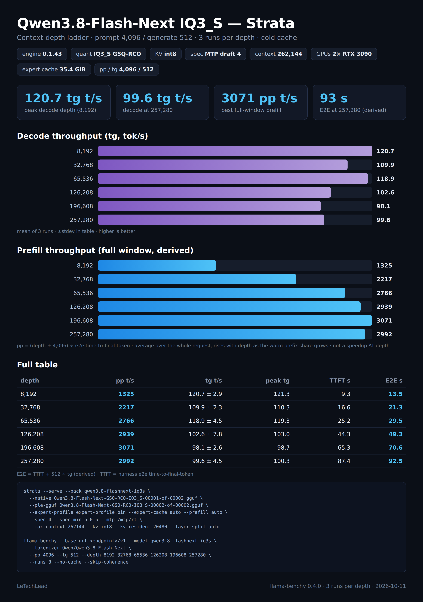
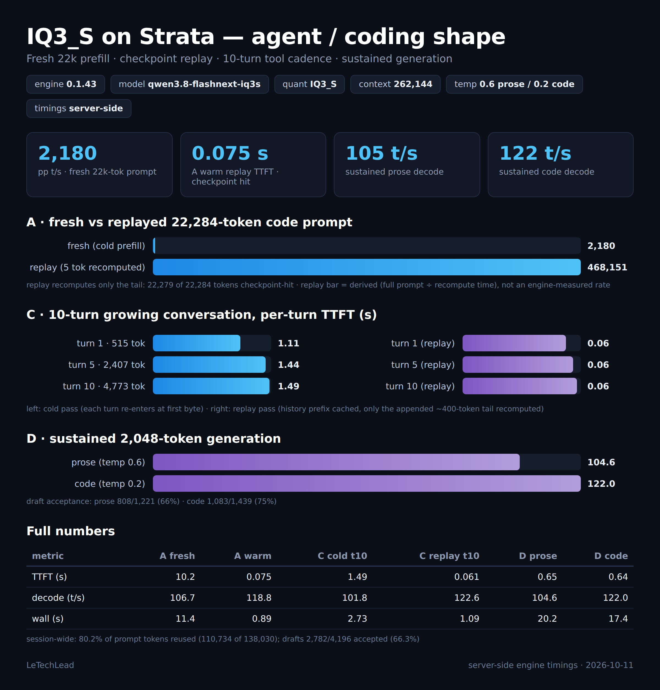

# Strata running Qwen3.8-Flash-Next IQ3_S on 2x RTX 3090 — a containerized recipe

Runs [Strata](https://github.com/Niko1221/Strata) (v0.1.43, MIT) on the 125B MoE
`Qwen3.8-Flash-Next-GSQ-RCO-IQ3_S` GGUFs from [ISTA-DASLab](https://huggingface.co/ISTA-DASLab/Qwen3.8-Flash-Next-GSQ-RCO-GGUF)
without ever executing Strata's own installer on your host: the engine is compiled inside Docker from
the checksum-pinned upstream tag, the model files are fetched with sha256 verification, and the runtime
container has **no network access at all** — which also means the engine can never self-update under you.

Why bother: Strata's installer (`setup.py`) is honest software — no hidden endpoints, no persistence, no
telemetry (I read it line by line before building this) — but it compiles on your host with `sudo`,
pulls a CUDA toolkit onto your system, re-downloads its binary from GitHub releases at every start,
and keeps its own venv and state outside your service manager. On a box that already serves other models,
that's pollution. This recipe keeps only what the installer actually does that matters — compile the
source, pack the GGUF, launch the same two processes — and gives it an image and a compose file.

## What you get
- OpenAI-compatible `POST /v1/chat/completions` and Anthropic-compatible `POST /v1/messages`,
  plus `GET /health`, `GET /metrics` (per-request reuse and hit-rate counters; Prometheus text
  format via `Accept`).
- The engine's own flags work as upstream documents them: prompt-checkpoint reuse, MTP draft layer
  (speculative decode), two-card layer split with a VRAM expert cache, **262,144-token context** —
  the IQ3_S shards' native trained window (`qwen4exp.context_length` in the GGUF metadata).
- Current CUDA defaults that show up in the start log on this box: route tail skip ON
  (`STRATA_ROUTE_TAIL_SKIP=7`, skips low-rank missed experts, answers differ slightly from
  `=0` — the log prints the exact toggle), measured PCIe-share probing, HTTP backlog 256, tokenizer
  cache, NaN guard. No opt-in flags are needed for any of it.

## Hardware floor (measured, this exact config)
- 2x RTX 3090 (48 GB VRAM): engine loads dense weights + KV + an 18,415-slot expert cache (36,248 MiB
  across the pair); VRAM runs near-full (~457 MiB free — keep your other GPU services off).
- ~62 GB system RAM: the 512-expert MoE arena (~48 GB, measured 47,962 MiB at load) is pinned; the rest
  streams from SSD. With a serving stack resident, budget nothing else: it fits only when the box is
  mostly free.
- ~85 GB free disk for shards + pack + MTP (shard 2 is byte-identical across all GSQ-RCO sizes — link
  it, don't refetch).
- NVIDIA driver ≥ 580 (CUDA 13 runtime).
- **Context ceiling:** 262,144 is hard. Above native, YaRN extrapolation steals VRAM from the GPU expert
  cache — slots collapse and decode craters — and past ~3M the session allocation fails outright. Don't
  raise `--max-context`; the native window is the recipe.

## Steps
```bash
# 0. build the engine image (fetches llama.cpp 3cf03257, verifies sha256)
./scripts/fetch-strata.sh                       # repo @ tag v0.1.43 -> ./strata-src/
docker build -t strata:0.1.43 .                 # ~15 min on a 12-core box

# 1. model weights (resumable, sha256-verified against HuggingFace LFS oids)
./scripts/fetch-model.sh ./models

# 2. pack + MTP draft layer — runs entirely inside the image
./scripts/prepare-data.sh ./models ./data

# 3. serve
cp config/iq3s.json.example config/iq3s.json    # set api_key, port as you like
docker compose up -d                            # healthcheck on /health
```

Clients (any OpenAI SDK): base URL `http://<host>:8080/v1`, model name `qwen3.8-flashnext-iq3s`.
Anthropic-style clients: `http://<host>:8080/v1/messages`.

Build-side note: the vision sub-project (`tools/vision`) defaults `STRATA_PORTABLE` to ON; this
Dockerfile passes `-DSTRATA_PORTABLE=OFF` explicitly (as upstream's own build does) to keep the native
CPU tuning instead of the portable AVX2 encoder.

## Benchmark 1: context ladder (`benchmark/context-ladder.png`)



llama-benchy 0.4.0 · pp 4,096 / tg 512 · 3 runs per depth · unique requests (`--no-cache`) ·
latency mode api · depths 8,192 → 257,280 (the top rung is 98% of the 262,144 window) ·
tokenizer `Qwen/Qwen3.8-Flash-Next` · engine restarted into a clean load window ·
raw benchy table: `benchmark/context-ladder-0.1.43.md` (a harness run that falls back to the `gpt2`
tokenizer is not a valid row source — pass the tokenizer explicitly).

| depth | prefill t/s | decode t/s | peak decode | TTFT | E2E (est.) |
|---|---|---|---|---|---|
| 8,192 | 1,325 | 120.7 ± 2.9 | 121.3 | 9.3 s | 13.5 s |
| 32,768 | 2,217 | 109.9 ± 2.3 | 110.3 | 16.6 s | 21.3 s |
| 65,536 | 2,766 | 118.9 ± 4.5 | 119.3 | 25.2 s | 29.5 s |
| 126,208 | 2,939 | 102.6 ± 7.8 | 103.0 | 44.3 s | 49.3 s |
| 196,608 | 3,071 | 98.1 ± 2.6 | 98.7 | 65.3 s | 70.6 s |
| 257,280 | 2,992 | 99.6 ± 4.5 | 100.3 | 87.4 s | 92.5 s |

Prefill rate = (depth + 4,096) ÷ full-prefill wall time — an average over the whole request, rising
with depth as the warm prefix share grows, not a speedup AT depth. E2E (est.) = TTFT + 512 ÷ decode
(derived). The shallow rungs' wall includes the cold-window CUDA-graph build. Decode holds ~98–103 t/s
from 126k to 257k.

## Benchmark 2: agent-shape results (`benchmark/`)



`agent-shape-card.html` is the editable source of the PNG above; `agent-bench-results.json` and
`cd-matched-results.json` are the raw per-request artifacts behind it. Measured on v0.1.43 with
server-side engine timings (not client estimates), engine restarted into a clean session, D at the
published temperatures (0.6 prose / 0.2 code), the numbers that matter for coding agents:

| scenario | result |
|---|---|
| fresh 22,284-token prompt prefill | 10.2 s (2,180 t/s) |
| same prompt replayed (checkpoint warm) | **0.075 s TTFT** — only 5 new tokens recompute (47.6 ms prompt) |
| warm decode | 118–132 t/s (replay mean 126.5) |
| sustained 2,048-token decode | prose 104.6 t/s / code 122.0 t/s (temp-matched) |
| MTP accept | prose 66% (808/1,221) / code 75% (1,083/1,439) on sustained runs; session-wide 66.3% |
| 10-turn growing conversation | cold turns TTFT 1.11→1.49 s; replay pass 0.055→0.061 s/turn, decode ~115.4 t/s |
| session-wide | 80.2% of prompt tokens reused (110,734 of 138,030); 0 aborts |

The cliff is the whole story: the first turn on a new 22k context costs ~10 s; every turn that keeps its
prefix costs ~0.075 s. Agents that reuse sessions feel this engine; agents that re-dump context pay the
IQ3_S byte tax on every one.

Also measured: a custom agentic coding suite (8 shell-tool tasks × 3 passes, native function calling,
temp 0) at **21/24 = 87.5%** (7/8, 7/8, 7/8). The only failing task is `file-pipeline` (3/3); every
failure is a test exit-1 with zero harness errors. Terminal-Bench 2.1 subset (8 expert-level tasks via
the official Harbor harness): 7 of 8 trials scored with reward 0.0 — the agent loop runs to the full
turn budget without producing the required artifacts; it reads as task difficulty, not plumbing. One
trial (`kv-live-surgery`) ended in an HTTP 400 from the endpoint and scored nothing.

## Layout
```
Dockerfile                     two-stage build (devel->compile -> runtime)
scripts/fetch-strata.sh        pinned repo tarball (tag v0.1.43) + sha256
scripts/fetch-model.sh         IQ3_S shards + sha256 (shard 2 dedupe documented inline)
scripts/prepare-data.sh        pack + tokenizer + MTP range-fetch/pack/rt (inside the image)
config/iq3s.json.example       server.py config (exe/args/gpu list = layer split)
docker-compose.yml             service definition, no egress at runtime
benchmark/                     both cards (PNG + HTML source) + raw artifacts
NOTICE / LICENSE               provenance
```
`strata-src/`, `models/`, `data/`, `config/iq3s.json` are gitignored — everything is reproducible via the scripts.

## Provenance / licenses
- Strata engine + server: © Niko1221 and the Strata contributors, MIT — https://github.com/Niko1221/Strata @ `v0.1.43` (commit `16374b3e`, tarball sha256 `16ecfb44dbd322b9…`).
- llama.cpp (ggml/gguf-py/mtmd) pinned at `3cf03257f219`, MIT (unchanged by Strata through v0.1.43; re-verified in v0.1.43's CMakeLists + setup.py 2026-10-11).
- Model weights: Qwen team + GSQ-RCO quants by ISTA-DASLab — see the HF repo's terms; you fetch them yourself. IQ3_S shard1 `4c1eb2ceb4915e11…` (54,817,524,224 B), shard2 `316b46f3a2dbd68c…` (28,800,138,432 B) — both match the HF LFS oids (re-checked against the live tree 2026-10-11).
- Scripts/Dockerfile/README in this repo: MIT.

Recipe and benchmark: @LeTechLead
